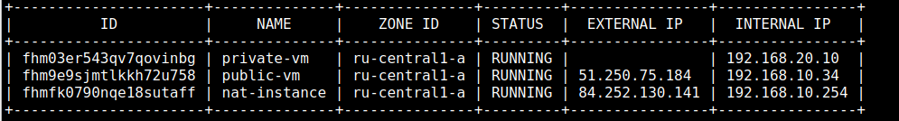
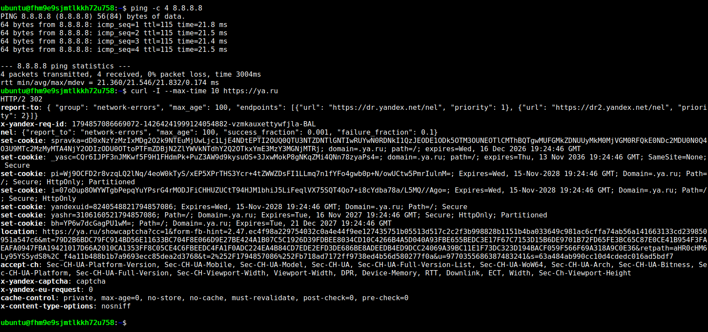
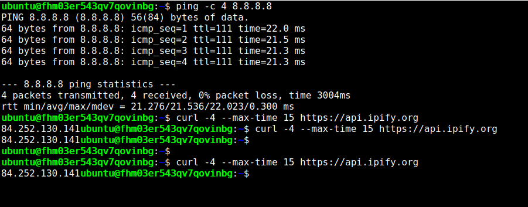
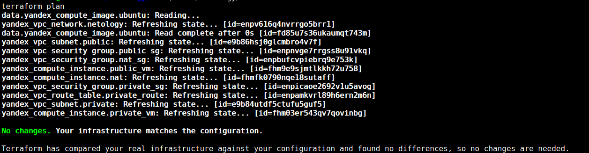

# Домашнее задание 15.1 — Организация сети

## Задание 1. Yandex Cloud

Инфраструктура развёрнута с помощью Terraform в Yandex Cloud.

**Зона доступности:** `ru-central1-a`.

### 1. Схема инфраструктуры

```text
                         Internet
                            |
              +-------------+-------------+
              |                           |
         public-vm                   nat-instance
       192.168.10.34                192.168.10.254
              |                           |
              +---------------------------+
                       Public subnet
                      192.168.10.0/24
                            |
                       netology-vpc
                            |
                      Private subnet
                     192.168.20.0/24
                            |
                        private-vm
                       192.168.20.10
                            |
                       Route table
                 0.0.0.0/0 -> 192.168.10.254
                            |
                       NAT instance
                            |
                         Internet
```

### 2. Созданные ресурсы

- VPC: `netology-vpc`.
- Публичная подсеть: `192.168.10.0/24`.
- Приватная подсеть: `192.168.20.0/24`.
- NAT-инстанс: `192.168.10.254`.
- Публичная ВМ: `public-vm`.
- Приватная ВМ: `private-vm`.
- Таблица маршрутизации: `private-route`.
- Отдельные группы безопасности для виртуальных машин.

### 3. Виртуальные машины

Созданы три виртуальные машины. Приватная ВМ не имеет публичного IP.



### 4. Проверка публичной подсети

Выполнено SSH-подключение к `public-vm`.

Проверена доступность интернета:

`ping -c 4 8.8.8.8`

`curl -I https://ya.ru`

Результат: интернет доступен.



### 5. Проверка приватной подсети

Подключение к `private-vm` выполнено через публичную виртуальную машину с использованием SSH ProxyJump.

Проверка доступа в интернет:

`ping -c 4 8.8.8.8`

Результат: 0% потерь пакетов.

Проверка внешнего IP:

`curl -4 https://api.ipify.org`

Результат: `84.252.130.141`.

Полученный адрес совпадает с внешним IP NAT-инстанса. Это подтверждает выход приватной виртуальной машины в интернет через NAT.



### 6. Проверка Terraform

Выполнена команда:

`terraform plan`

Результат:

`No changes. Your infrastructure matches the configuration.`



### 7. Terraform-файлы

- `providers.tf` — провайдер Yandex Cloud.
- `network.tf` — VPC и подсети.
- `nat.tf` — NAT-инстанс.
- `nat-sg.tf` — группа безопасности NAT.
- `public-vm.tf` — публичная ВМ.
- `private-vm.tf` — приватная ВМ.
- `routes.tf` — таблица маршрутизации.

## Результат

Обязательное задание Yandex Cloud выполнено.

Создана инфраструктура с публичной и приватной подсетями. Проверен доступ в интернет с обеих виртуальных машин. Подтверждена работа маршрутизации через NAT-инстанс.

Все ресурсы соответствуют Terraform-конфигурации.
